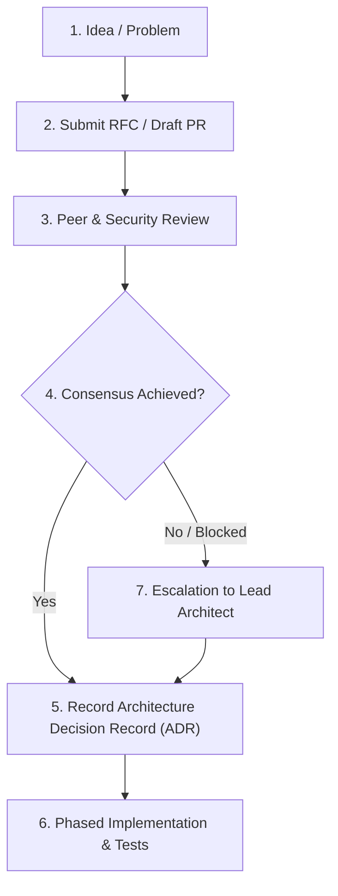

# Governance & Decision Framework

This document outlines project leadership, architectural ownership, technical decision processes, and conflict escalation paths across `@OxDurgeshxO` repositories.

---

## 1. Project Roles & Responsibilities

| Role | Responsibilities | Key Persons |
|---|---|---|
| **Lead Architect / Maintainer** | Technical vision, architectural approvals, release management, final sign-off on breaking changes. | Durgesh Dutt Sinha (`@OxDurgeshxO`) |
| **Domain Leads** | Subsystem stewardship (CV/ML, Backend API, Realtime/Systems, Frontend UX). | Designated CODEOWNERS |
| **Contributors** | Feature implementation, test authoring, documentation, issue triaging. | Open source & internal collaborators |
| **Automated Agents** | Linting, dependency audits, security scanning, CI validation, benchmark tracking. | GitHub Actions, Antigravity CI |

---

## 2. Technical Decision Process (ADR / RFC)

Major changes to architecture, protocols, or infrastructure follow a structured RFC / ADR process:

1. **RFC Proposal**: Contributor creates an issue or draft PR utilizing `RFC_TEMPLATE.md` outlining the motivation, system boundaries, alternatives, and security review.
2. **Review Window**: 5 business days for architectural feedback and discussion.
3. **Architecture Decision Record (ADR)**: Approved decisions are permanently archived in the repository's `docs/architecture/decisions/` directory following `ADR_TEMPLATE.md`.

---

## 3. Conflict Escalation Path

If consensus cannot be reached within standard PR reviews:
1. **Tier 1 (Technical Debate)**: Domain Leads and PR author present benchmark data, test proof, or formal RFC comparisons.
2. **Tier 2 (Architecture Escalation)**: The question is brought to the Lead Architect (`@OxDurgeshxO`) who will evaluate against system goals:
   - Security and data privacy take precedence over convenience.
   - Deterministic reliability and testability take precedence over novel complexity.
   - Standard reusable primitives take precedence over bespoke one-off implementations.
3. **Tier 3 (Binding Decision)**: Lead Architect renders a definitive decision and documents the rationale in an ADR.

---

## 4. Code of Conduct Enforcement

All community interactions and review discussions adhere to [CODE_OF_CONDUCT.md](./CODE_OF_CONDUCT.md). Harassment, abusive comments, or bad-faith behavior results in immediate escalation, issue locking, and account blocking.
