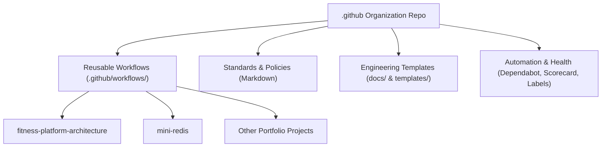

# Project Overview: .github (Organization Engineering Operating System)

## Problem
In a rapidly expanding multi-repository portfolio spanning AI agents, computer vision, web applications, and low-level systems programming, maintaining uniform quality, security, and developer velocity is difficult. Without centralized standards, repositories suffer from configuration drift, fragmented CI workflows, disparate issue handling, unpinned dependencies, and unpredictable release lifecycles.

## Solution
This `.github` community and governance repository acts as the central engineering operating system for `@OxDurgeshxO`. It centralizes reusable GitHub Actions workflows, organization-wide engineering and AI usage policies, issue/PR governance templates, Dependabot configurations, and objective health scorecards.

## Key Features
- **Central Reusable Workflows**: Modular CI, Security, Release, Docker, Documentation, Performance Benchmarks, Node/TS, and AI Evaluation pipelines callable across any repository.
- **Enterprise Governance Standards**: Rigorous `ENGINEERING_STANDARDS.md`, `AI_USAGE_POLICY.md`, `RELEASE_PROCESS.md`, `GOVERNANCE.md`, and `SUPPORT.md`.
- **Structured Issue & PR Automation**: Standardized YAML issue forms (Bug Report, Feature Request, Task, Documentation) and pull request templates with security and testing checklists.
- **Reusable Documentation Framework**: Standardized templates for ADRs, RFCs, Postmortems, Test Plans, Security Reviews (OWASP ASVS), AI Feature Reviews, Release Checklists, and Onboarding Guides.
- **Objective Health Scorecard**: Standardized `REPOSITORY_HEALTH.md` establishing explicit thresholds for test coverage (>=70% overall, >=85% core), zero vulnerabilities, and 100% CI pass rate.

## Architecture

## Tech Stack
- **Automation & Orchestration**: GitHub Actions (workflow_call, matrix builds, artifact archiving)
- **Security & SAST**: GitHub CodeQL, Gitleaks, Dependabot, Trivy
- **Documentation & Linting**: Markdownlint, Lychee link checker, Mermaid.js
- **Release Automation**: Changesets, GitHub Container Registry (GHCR)

## Demo
All repositories in `@OxDurgeshxO` call the centralized reusable workflows defined here, achieving 100% automated enforcement of typechecking, security audits, and release packaging.

## Metrics
- **Reusable Workflows**: 9 production-grade workflows covering CI, Security, Docker, Docs, Release, Performance, AI-eval, Node, and Python.
- **Standard Templates**: 8 reusable engineering doc templates + 4 structured YAML issue forms.
- **Target Pass Rate**: 100% CI pass rate across all organization repositories.
- **Vulnerability Ceiling**: 0 critical or high open vulnerabilities.

## Roadmap
- [x] Initial organization-wide engineering baseline & reusable workflows.
- [x] Comprehensive AI usage and safety policy.
- [x] OWASP ASVS-aligned security review template.
- [ ] Automated Slack / Discord webhook notifications on release completion.
- [ ] Organization-wide dependency graph and vulnerability dashboard.

## What I Learned
Establishing shared CI/CD primitives and declarative governance early prevents technical debt and cognitive overhead. Reusable workflows with explicit `workflow_call` contracts drastically reduce boilerplate in individual repositories while enforcing security standards (least-privilege permissions, commit SHA pinning, and automated dependency scanning) organization-wide.
