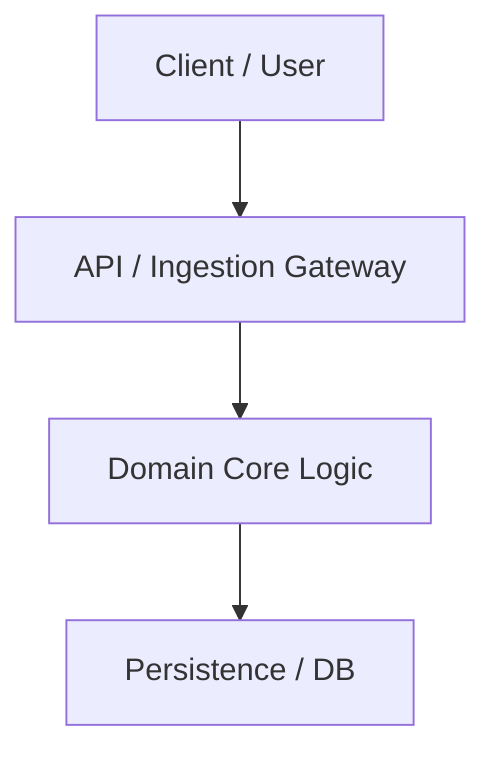

# RFC-XXXX: [Feature or Architectural Proposal Title]

- **Author(s)**: [Name / GitHub Handle]
- **Status**: [Draft | In Review | Approved | Rejected | Implemented]
- **Created**: [YYYY-MM-DD]
- **Target Release**: [e.g., v1.2.0 / Milestone]

---

## 1. Summary
A concise executive summary (1–2 paragraphs) describing the proposed capability and why it should be built.

## 2. Motivation & Background
Why is this change necessary? What specific user pain points, system bottlenecks, or technical debt does it address? Include metric targets where applicable.

## 3. Detailed Design & Architecture
Provide technical specifications:
- **System Boundaries & Components**: Data flow, interfaces, schemas.
- **Data Model Changes**: Entity-relationship changes, migrations, retention.
- **API Contracts**: REST endpoints, WebSocket event payloads, or CLI commands.
- **State Machine / Control Flow**: State transitions, failure handling, recovery paths.

## 4. Alternative Approaches Considered
What other architectures, libraries, or patterns were evaluated? Why were they not chosen?

## 5. Security, Privacy & Compliance
- What are the threat modeling boundaries?
- Is any PII or sensitive data captured or processed?
- How are inputs validated and sanitized?
- Rate limiting and authorization requirements.

## 6. Observability & Operations
- What metrics, logs, and traces will be emitted?
- What are the alert thresholds?
- Deployment and migration sequencing.

## 7. Rollout & Rollback Plan
- Feature flag enablement.
- Rollback criteria and backward compatibility guarantees.

## 8. Open Questions & Unresolved Issues
- [ ] Question 1...
- [ ] Question 2...
