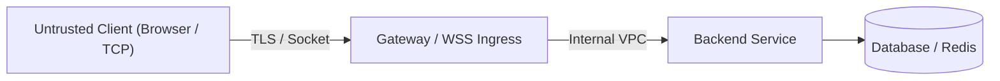

# Security Review & Threat Model: [System / Subsystem Name]

- **Reviewer(s)**: [Security Lead / Reviewer Handle]
- **Date**: [YYYY-MM-DD]
- **Repository**: [Repository Name]
- **ASVS Level Target**: [ASVS Level 1 (Standard) | ASVS Level 2 (Sensitive/Health/Auth)]

---

## 1. System Architecture & Assets
- **Description**: What does this service do, what assets does it handle?
- **Data Assets**:
  - Credentials / Auth Tokens
  - User Video Frames / Pose Landmarks
  - Workout History & Telemetry
  - Database Records & Cache Entries

---

## 2. Trust Boundaries & Attack Surface

### Trust Boundary Analysis
1. **Client to Edge Ingress**: Public Internet, untrusted inputs, malicious TCP frames, prompt injection payloads.
2. **Edge Ingress to Internal Services**: Internal authenticated RPC/PubSub.
3. **Internal Services to Storage**: Protected database connection strings, encrypted at rest.

---

## 3. Threat Modeling (STRIDE Methodology)

| Threat Category | Description / Vulnerability Vector | Likelihood | Impact | Mitigation Strategy |
|---|---|---|---|---|
| **Spoofing** | Forged user identities or JWT manipulation | Low | High | Cryptographic JWT signing with rotation, auth middleware guards |
| **Tampering** | Modification of workout data or pose event packets in transit | Low | Med | TLS 1.3 encryption, WebSocket checksum/signature validation |
| **Repudiation** | Denying completed workout or administrative action | Low | Low | Immutable audit logging with correlation IDs |
| **Information Disclosure** | Camera video frames leaked or saved to cloud disk | Med | Critical | Zero cloud video storage; client-side on-device inference; ephemeral landmarks only |
| **Denial of Service** | Flooding TCP socket or unparsed bulk strings | Med | High | Connection limits, backpressure handling, request rate limiting |
| **Elevation of Privilege** | Escalating from regular user to admin or cross-tenant query | Low | Critical | Strict multi-tenant row-level access control & role validation |

---

## 4. OWASP ASVS Verification Checklist

- [ ] **V1 Architecture & Threat Modeling**: Boundaries and assets documented.
- [ ] **V2 Authentication**: Strong passwords, token expiration, brute-force mitigation.
- [ ] **V3 Session Management**: Secure, HttpOnly, SameSite cookies, session invalidation.
- [ ] **V4 Access Control**: Principle of least privilege, direct object reference guards.
- [ ] **V5 Input Validation**: Strict validation against allow-lists and Zod schemas before processing.
- [ ] **V6 Cryptography**: Industry-standard ciphers (AES-GCM, Argon2/bcrypt, SHA-256).
- [ ] **V7 Error Handling & Logging**: No sensitive data or internal stack traces leaked to clients.
- [ ] **V8 Data Protection**: Sensitive fields masked, ephemeral storage policies strictly observed.

---

## 5. Security Sign-off
- **Risk Assessment**: [Acceptable | Mitigations Required]
- **Approver**: [@OxDurgeshxO]
